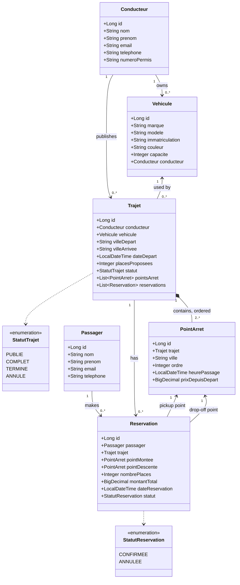

# Multi-Stop Carpooling Platform

[](https://spring.io/projects/spring-boot)
[](https://www.oracle.com/java/)
[](https://www.postgresql.org/)
[](https://www.docker.com/)
[](https://junit.org/junit5/)
[](http://localhost:8080/swagger-ui/index.html)

A complete REST API backend for a carpooling platform that supports **multi-stop trips**, **per-segment dynamic pricing**, and strict enforcement of business rules.

---

## Table of Contents

1. [Overview & Goals](#overview--goals)
2. [Tech Stack](#tech-stack)
3. [Architecture](#architecture)
4. [Data Model & UML Diagram](#data-model--uml-diagram)
5. [Business Rules & Validation Scenarios](#business-rules--validation-scenarios)
6. [Quick Start](#quick-start)
7. [API Documentation & Swagger UI](#api-documentation--swagger-ui)
8. [Postman Collection](#postman-collection)
9. [Project Tracking & Git Workflow](#project-tracking--git-workflow)
10. [Testing](#testing)

---

## Overview & Goals

What sets this platform apart is its support for **trips with intermediate stops**. A driver can publish a trip from **Casablanca** to **Marrakech** with a stop in **Settat**. Passengers can book a seat for the whole journey or for any segment of it (e.g. *Settat → Marrakech*).

### Key Features

- Manage drivers, passengers, and vehicles (ownership and capacity rules).
- Publish trips as chronologically ordered stops, each carrying a cumulative price from the departure point.
- Search trips between any two stops, respecting the direction of travel, using a **single optimized JPQL query**.
- Automatically compute the booking total:

  ```
  total = (price_at_dropoff − price_at_pickup) × number_of_seats
  ```

- Compute remaining seats dynamically, with no redundant persisted counter.
- Handle automatic and manual trip lifecycle transitions, and booking cancellation under the 24-hour rule.

---

## Tech Stack

| Area | Technology |
| :--- | :--- |
| Language | Java 17 (LTS) |
| Framework | Spring Boot 3.3.4 (`web`, `data-jpa`, `validation`) |
| API docs | springdoc-openapi-starter-webmvc-ui 2.5.0 (Swagger UI / OpenAPI 3) |
| Persistence | PostgreSQL 16 (production / Docker), H2 in-memory (fast local development) |
| Tooling | Lombok, MapStruct 1.5.5.Final, Java Records for DTOs |
| Error handling | `@RestControllerAdvice` with RFC 7807 `ProblemDetail` |
| Logging | SLF4J (`INFO` for business actions, `WARN` for rule rejections) |
| Testing | JUnit 5, Mockito, AssertJ |

---

## Architecture

The project follows a **strict layered architecture** for clear separation of concerns and easy testing.

> **Note:** Package, class, and field names (e.g. `Conducteur`, `Trajet`, `PointArret`) are kept in French as in the source code. Equivalents: *Conducteur* = Driver, *Passager* = Passenger, *Vehicule* = Vehicle, *Trajet* = Trip, *PointArret* = Stop, *Reservation* = Booking.

```
src/main/java/com/covoiturage/
├── CovoiturageApplication.java   # Spring Boot entry point
├── config/                       # OpenAPI configuration, DataInitializer
├── domain/
│   ├── entity/                   # JPA entities (Conducteur, Passager, Vehicule, Trajet, PointArret, Reservation)
│   ├── enums/                    # StatutTrajet, StatutReservation
│   └── repository/               # Spring Data JPA repositories & JPQL queries
├── dto/
│   ├── request/                  # Request records with validation annotations
│   └── response/                 # Response records
├── exception/                    # Business exceptions and GlobalExceptionHandler (ProblemDetail)
├── mapper/                       # MapStruct mappers (entity <-> DTO)
├── service/                      # Business service interfaces
│   └── impl/                     # Transactional implementations (@Transactional)
└── web/
    └── controller/               # REST controllers (@RestController)
```

---

## Data Model & UML Diagram



---

## Business Rules & Validation Scenarios

### Roles & Permissions

| Role | Can | Cannot |
| :--- | :--- | :--- |
| **Driver** | Create an account, register vehicles, publish trips with their own vehicles, view bookings on their trips, complete or cancel their trips | Book seats |
| **Passenger** | Create an account, search and view trips, book seats, view and cancel their own bookings | Publish trips, view other passengers' bookings |

### Trip Lifecycle

`PUBLIE` → `COMPLET` (when all seats are booked) → back to `PUBLIE` (if a booking is cancelled) → `TERMINE` (completed by the driver after departure) or `ANNULE` (cancelled by the driver).

### The 11 Validation Scenarios

| # | Scenario | Test Data | Expected Result | Status |
| :-: | :--- | :--- | :--- | :-: |
| 1 | Salma books 1 seat Settat → Marrakech | Hamid's trip (Settat at 70 DH, Marrakech at 120 DH) | **201**; total **50 DH**; **2 seats remaining** | ✅ |
| 2 | Karim searches Settat → Casablanca | Hamid's trip runs the opposite way (stop 2 → stop 1) | **200**; Hamid's trip **does not appear** | ✅ |
| 3 | Karim books 2 seats Casablanca → Marrakech | Casablanca at 40 DH, Marrakech at 120 DH, 2 seats | **201**; total **160 DH**; trip becomes **COMPLET** | ✅ |
| 4 | Imane books 1 seat on the full trip | Hamid's trip is now COMPLET | **409 Conflict** | ✅ |
| 5 | Karim cancels his booking 3 days ahead | Cancellation 72 h before departure | **204 No Content**; trip returns to **PUBLIE** | ✅ |
| 6 | Imane books with pickup in Marrakech and drop-off in Settat | Pickup order (3) > drop-off order (2) | **400 Bad Request**; pickup is after drop-off | ✅ |
| 7 | Hamid offers 5 seats in a 4-seat vehicle | Dacia Logan (max capacity: 4) | **400 Bad Request**; 4 seats maximum | ✅ |
| 8 | Hamid publishes using another driver's vehicle | Vehicle belongs to Youssef | **403 Forbidden** | ✅ |
| 9 | Hamid completes the trip before 17:00 on departure day | Completion attempted before departure time | **409 Conflict** | ✅ |
| 10 | Salma cancels 2 hours before departure | Cancellation less than 24 h before departure | **409 Conflict**; 24-hour deadline passed | ✅ |
| 11 | Hamid cancels a trip that has two bookings | Transactional bulk cancellation | **204 No Content**; trip and bookings cancelled together | ✅ |

---

## Quick Start

### Prerequisites

- Java 17+
- Maven 3.8+ (or the Maven Wrapper)
- Docker & Docker Compose

### 1. Start PostgreSQL with Docker Compose

```bash
docker-compose up -d
```

The container creates the `covoiturage_db` database and loads 5+ records into each table via `docker/init.sql`.

### 2. Start the Spring Boot application

```bash
# With the PostgreSQL profile (Docker)
mvn spring-boot:run -Dspring-boot.run.profiles=postgres

# Or with the default in-memory H2 profile (zero setup)
mvn spring-boot:run
```

The application listens on port `8080`. On first startup, the `DataInitializer` component seeds at least 5 records into each table.

---

## API Documentation & Swagger UI

Once the application is running (`mvn spring-boot:run`), interactive API documentation is available at:

- **Swagger UI (Interactive Docs)**: <http://localhost:8080/swagger-ui/index.html> (or simply <http://localhost:8080/>)
- **OpenAPI 3 JSON Spec**: <http://localhost:8080/v3/api-docs>

> **Note**: These links require the Spring Boot backend to be running locally on port 8080. If the server is not started, your browser will show a connection error (`ERR_CONNECTION_REFUSED`).

### Main REST Endpoints

| Method | Endpoint | Description | Success |
| :--- | :--- | :--- | :--- |
| `POST` | `/api/v1/conducteurs` | Create a driver account | `201 Created` |
| `GET` | `/api/v1/conducteurs` | List drivers (paginated) | `200 OK` |
| `POST` | `/api/v1/passagers` | Create a passenger profile | `201 Created` |
| `POST` | `/api/v1/vehicules` | Register a vehicle (capacity 1–8) | `201 Created` |
| `DELETE` | `/api/v1/vehicules/{id}` | Delete a vehicle (only if it has no trips) | `204 No Content` |
| `POST` | `/api/v1/trajets` | Publish a multi-stop trip | `201 Created` |
| `GET` | `/api/v1/trajets/{id}` | Get trip details | `200 OK` |
| `GET` | `/api/v1/trajets/recherche` | Search trips between two stops | `200 OK` |
| `PUT` | `/api/v1/trajets/{id}/terminer` | Complete a trip (after departure) | `200 OK` |
| `PUT` | `/api/v1/trajets/{id}/annuler` | Cancel a trip and its bookings | `204 No Content` |
| `POST` | `/api/v1/reservations` | Book seats on a segment | `201 Created` |
| `DELETE` | `/api/v1/reservations/{id}` | Cancel a booking (more than 24 h before departure) | `204 No Content` |

Errors follow RFC 7807 (`ProblemDetail`) with status codes `400`, `403`, `404`, and `409`.

---

## Postman Collection

A ready-to-use Postman collection is available at:
`docs/postman/covoiturage-multi-etapes.postman_collection.json`

It includes:

- A dedicated **11 Validation Scenarios** folder with automated assertions on HTTP status codes and JSON response bodies.
- CRUD requests for drivers, passengers, vehicles, and bookings.

---

## Project Tracking & Git Workflow

- **Agile tracking file:** `docs/JIRA.md`
- **Branching strategy (Git Flow):**
  - `main`: stable release branch
  - `develop`: main integration branch
  - Feature branches:
    - `feature/COV-01-initial-project-setup`
    - `feature/COV-02-driver-management`
    - `feature/COV-03-passenger-management`
    - `feature/COV-04-vehicle-management`
    - `feature/COV-05-trip-publication`
    - `feature/COV-06-trip-search`
    - `feature/COV-07-booking-management`
    - `feature/COV-08-trip-lifecycle`
    - `feature/COV-09-docker-compose-seeding`
    - `feature/COV-10-unit-tests-validation`
    - `feature/COV-11-postman-uml-documentation`
- **Commits:** 50+ commits following the [Conventional Commits](https://www.conventionalcommits.org/) format.

---

## Testing

Run the full automated test suite:

```bash
mvn test
```

JUnit 5, Mockito, and AssertJ cover both the happy paths and the error cases (400, 403, 404, 409) across all 11 validation scenarios.