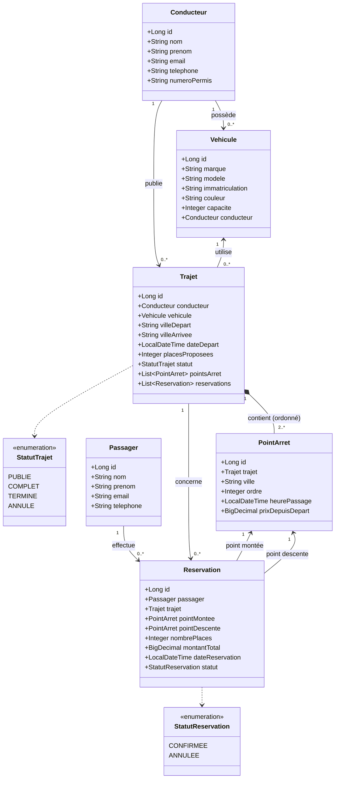

# Plateforme de Covoiturage Multi-Étapes

[](https://spring.io/projects/spring-boot)
[](https://www.oracle.com/java/)
[](https://www.postgresql.org/)
[](https://www.docker.com/)
[](https://junit.org/junit5/)
[](http://localhost:8080/swagger-ui.html)

Backend API REST complet pour une plateforme de covoiturage innovante permettant la proposition et la réservation de trajets multi-étapes avec tarification dynamique par segment et gestion stricte des règles métier.

---

## 📋 Table des Matières

1. [Contexte & Objectifs](#-contexte--objectifs)
2. [Stack Technique](#-stack-technique)
3. [Architecture Logicielle](#-architecture-logicielle)
4. [Modèle de Données & Diagramme UML](#-modèle-de-données--diagramme-uml)
5. [Règles Métier Critiques & Scénarios de Validation](#-règles-métier-critiques--scénarios-de-validation)
6. [Lancement Rapide](#-lancement-rapide)
7. [Documentation API & Swagger UI](#-documentation-api--swagger-ui)
8. [Collection Postman](#-collection-postman)
9. [Suivi de Projet JIRA & Gestion Git](#-suivi-de-projet-jira--gestion-git)
10. [Tests Unitaires & Couverture](#-tests-unitaires--couverture)

---

## 🎯 Contexte & Objectifs

La particularité de cette plateforme est la gestion des **trajets multi-arrêts intermédiaires**.  
Un conducteur peut publier un trajet de **Casablanca** vers **Marrakech** avec un arrêt à **Settat**. Les passagers ont la flexibilité de réserver une place sur la totalité du trajet ou sur un segment précis (ex : *Settat → Marrakech*).

### Objectifs Principaux
* Gérer les conducteurs, passagers et véhicules (règles de propriété et de capacité).
* Publier des parcours sous forme de points d'arrêt ordonnés chronologiquement avec prix cumulé depuis le départ.
* Rechercher des trajets entre deux étapes intermédiaires dans le bon sens de circulation via une **requête JPQL unique optimisée**.
* Calculer automatiquement le montant total des réservations :  
  $$\text{Montant total} = (\text{prix}_{\text{descente}} - \text{prix}_{\text{montée}}) \times \text{nombre de places}$$
* Calculer dynamiquement les places restantes sans stockage persistant redondant.
* Gérer les transitions automatiques et manuelles du cycle de vie des trajets et l'annulation des réservations dans le respect de la règle des 24 heures.

---

## 🛠️ Stack Technique

* **Langage & SDK** : Java 17 LTS
* **Framework Backend** : Spring Boot 3.3.4
  * `spring-boot-starter-web` (API REST)
  * `spring-boot-starter-data-jpa` (ORM Hibernate)
  * `spring-boot-starter-validation` (Bean Validation Hibernate Validator)
  * `springdoc-openapi-starter-webmvc-ui` 2.5.0 (Documentation Swagger / OpenAPI 3)
* **Persistance** : PostgreSQL 16 (production/docker), H2 Database in-memory (développement local rapide)
* **Outillage & Mapping** : Lombok & MapStruct 1.5.5.Final avec Records Java pour les DTOs
* **Gestion des Exceptions** : `@RestControllerAdvice` avec standard RFC 7807 `ProblemDetail`
* **Journalisation** : SLF4J (`INFO` pour les actions métier, `WARN` pour les refus de règles)
* **Tests** : JUnit 5, Mockito, AssertJ

---

## 🏛️ Architecture Logicielle

Le projet adopte une **architecture en couches stricte** garantissant la séparation des responsabilités et la testabilité :

```
src/main/java/com/covoiturage/
├── CovoiturageApplication.java          # Point d'entrée Spring Boot
├── config/                              # Configuration OpenAPI, DataInitializer
├── domain/
│   ├── entity/                          # Entités JPA (Conducteur, Passager, Vehicule, Trajet, PointArret, Reservation)
│   ├── enums/                           # Énumérations (StatutTrajet, StatutReservation)
│   └── repository/                      # Repositories Spring Data JPA & requêtes JPQL
├── dto/
│   ├── request/                         # Records DTO de requête avec annotations de validation
│   └── response/                        # Records DTO de réponse client
├── exception/                           # Exceptions métier et GlobalExceptionHandler (ProblemDetail)
├── mapper/                              # Mappers MapStruct (Entity <-> DTO Records)
├── service/                             # Interfaces de service métier
│   └── impl/                            # Implémentations transactionnelles (@Transactional)
└── web/
    └── controller/                      # Contrôleurs REST (@RestController)
```

---

## 📊 Modèle de Données & Diagramme UML

### Diagramme de Classes UML (Mermaid)



---

## ⚖️ Règles Métier Critiques & Scénarios de Validation

### Matrice des Droits & Rôles
* **Conducteur** : Peut créer son compte, enregistrer ses véhicules, publier des trajets avec ses propres véhicules, consulter les réservations de ses trajets, terminer ou annuler ses trajets. **Ne peut pas réserver de places**.
* **Passager** : Peut créer son compte, rechercher et consulter des trajets, réserver des places, consulter et annuler ses réservations. **Ne peut pas publier de trajets ni voir les réservations d'autres passagers**.

### Validation des 11 Scénarios du Brief

| # | Scénario | Données de Test | Résultat Attendu | Statut |
| :-: | :--- | :--- | :--- | :-: |
| **1** | Salma réserve 1 place Settat → Marrakech | Trajet Hamid (Settat à 70 DH, Marrakech à 120 DH) | **201** ; montant **50 DH** ; **2 places restantes** | ✅ Conforme |
| **2** | Karim recherche Settat → Casablanca | Trajet Hamid dans le sens inverse (ordre 2 vers ordre 1) | **200** ; le trajet de Hamid **n'apparaît pas** | ✅ Conforme |
| **3** | Karim réserve 2 places Casablanca → Marrakech | Casa à 40 DH, Marrakech à 120 DH, 2 places | **201** ; montant **160 DH** ; trajet devient **COMPLET** | ✅ Conforme |
| **4** | Imane réserve 1 place sur le trajet complet | Trajet Hamid devenu COMPLET | **409 Conflict** | ✅ Conforme |
| **5** | Karim annule sa réservation 3 jours avant | Réservation de Karim annulée 72h avant départ | **204 No Content** ; trajet redevient **PUBLIE** | ✅ Conforme |
| **6** | Imane réserve avec montée à Marrakech et descente à Settat | Ordre montée (3) > ordre descente (2) | **400 Bad Request** ; montée après la descente | ✅ Conforme |
| **7** | Hamid propose 5 places dans un véhicule de capacité 4 | Dacia Logan (capacité max : 4) | **400 Bad Request** ; 4 places au maximum | ✅ Conforme |
| **8** | Hamid publie avec le véhicule d'un autre conducteur | Véhicule appartenant à Youssef | **403 Forbidden** | ✅ Conforme |
| **9** | Hamid termine le trajet avant 17:00 le jour du départ | Tentative de clôture avant l'heure de départ | **409 Conflict** | ✅ Conforme |
| **10** | Salma annule 2 heures avant le départ | Tentative d'annulation à moins de 24h du départ | **409 Conflict** ; délai de 24 h dépassé | ✅ Conforme |
| **11** | Hamid annule un trajet qui a deux réservations | Annulation globale transactionnelle | **204 No Content** ; trajet et réservations annulés en bloc | ✅ Conforme |

---

## 🚀 Lancement Rapide

### Prérequis
* Java 17+ installé
* Maven 3.8+ (ou Maven Wrapper)
* Docker & Docker Compose

### 1. Démarrer PostgreSQL avec Docker Compose
```bash
docker-compose up -d
```
> Le conteneur initialise automatiquement la base `covoiturage_db` et injecte plus de 5 enregistrements dans chaque table via `docker/init.sql`.

### 2. Démarrer l'Application Spring Boot
```bash
# Avec le profil PostgreSQL (Docker)
mvn spring-boot:run -Dspring-boot.run.profiles=postgres

# Ou avec le profil H2 in-memory (prêt à l'emploi)
mvn spring-boot:run
```
L'application démarre sur le port `8080`.  
Grâce au composant `DataInitializer`, au moins 5 enregistrements sont automatiquement insérés dans chaque table dès le premier démarrage.

---

## 📖 Documentation API & Swagger UI

Accédez à la documentation interactive OpenAPI / Swagger UI :
👉 **[http://localhost:8080/swagger-ui.html](http://localhost:8080/swagger-ui.html)**  
Fichier JSON OpenAPI : **[http://localhost:8080/v3/api-docs](http://localhost:8080/v3/api-docs)**

### Principaux Endpoints REST

| Méthode | Endpoint | Description | Code Succès |
| :--- | :--- | :--- | :--- |
| `POST` | `/api/v1/conducteurs` | Créer un compte conducteur | `201 Created` |
| `GET` | `/api/v1/conducteurs` | Lister les conducteurs (paginé) | `200 OK` |
| `POST` | `/api/v1/passagers` | Créer un profil passager | `201 Created` |
| `POST` | `/api/v1/vehicules` | Enregistrer un véhicule (capacité 1 à 8) | `201 Created` |
| `DELETE` | `/api/v1/vehicules/{id}` | Supprimer un véhicule (si aucun trajet) | `204 No Content` |
| `POST` | `/api/v1/trajets` | Publier un trajet multi-étapes | `201 Created` |
| `GET` | `/api/v1/trajets/{id}` | Consulter le détail d'un trajet | `200 OK` |
| `GET` | `/api/v1/trajets/recherche` | Rechercher des trajets entre 2 étapes | `200 OK` |
| `PUT` | `/api/v1/trajets/{id}/terminer` | Clôturer un trajet (après départ) | `200 OK` |
| `PUT` | `/api/v1/trajets/{id}/annuler` | Annuler un trajet et ses réservations | `204 No Content` |
| `POST` | `/api/v1/reservations` | Réserver des places sur un segment | `201 Created` |
| `DELETE` | `/api/v1/reservations/{id}` | Annuler une réservation (> 24h) | `204 No Content` |

---

## 📮 Collection Postman

Une collection Postman complète et prête à l'emploi est disponible dans le dépôt :  
📁 `docs/postman/covoiturage-multi-etapes.postman_collection.json`

Elle contient :
* Un dossier dédié **🎯 11 Scénarios de Validation (Brief)** avec des assertions automatiques sur les statuts HTTP et les corps de réponses JSON.
* Tous les appels CRUD sur les conducteurs, passagers, véhicules et réservations.

---

## 📌 Suivi de Projet JIRA & Gestion Git

* **Fichier de suivi Agile** : `docs/JIRA.md`
* **Stratégie de Branches Git Flow** :
  * `main` : Branche de release stable
  * `develop` : Branche principale d'intégration
  * `feature/COV-01-initial-project-setup`
  * `feature/COV-01-gestion-conducteurs`
  * `feature/COV-03-gestion-passagers`
  * `feature/COV-04-gestion-vehicules`
  * `feature/COV-05-publication-trajets`
  * `feature/COV-06-recherche-trajets`
  * `feature/COV-07-gestion-reservations`
  * `feature/COV-08-cycle-de-vie-trajet`
  * `feature/COV-09-docker-compose-seeding`
  * `feature/COV-10-tests-unitaires-validation`
  * `feature/COV-11-documentation-postman-uml`
* **Nombre de commits** : **+50 commits professionnels** au format Conventional Commits.

---

## 🧪 Tests Unitaires & Couverture

Pour exécuter la suite de tests automatisée :
```bash
mvn test
```
Tous les scénarios nominaux et d'erreurs (400, 403, 404, 409) sont validés par JUnit 5, Mockito et AssertJ.
